# Tugas Praktikum 8 DPBO 2526 C2 (TP8DPBO2526C2)
Aplikasi **Academic System** berbasis **PHP Native** dengan arsitektur **Model-View-Controller (MVC)**, basis data MySQL melalui PDO (*Prepared Statements*), dan antarmuka Bootstrap untuk pengelolaan data Departemen, Dosen (*Lecturers*), serta Mata Kuliah (*Courses*).

---

## Janji

> Saya Muhammad Zidan Mirza Fedrieka dengan NIM 2507692 mengerjakan Tugas Praktikum 8 dalam mata kuliah Desain Pemrograman Berorientasi Objek untuk keberkahan-Nya maka saya tidak melakukan kecurangan seperti yang telah dispesifikasikan. Aamiin.

---

## 1. Desain Program & Arsitektur MVC

### A. Pemisahan Tanggung Jawab (*Model-View-Controller*)
1. **Model (`Project/models/`)**:
   - Mengelola koneksi database (`Project/config/Database.php`) dan seluruh kueri SQL menggunakan *Prepared Statements* PDO (`prepare()` dan `execute()`).
   - Terdiri atas `Department`, `Lecturer`, dan `Course`.
2. **View (`Project/views/`)**:
   - Menyajikan antarmuka HTML/Bootstrap kepada pengguna menggunakan data yang dikirimkan oleh Controller, tanpa berinteraksi langsung dengan database atau Model.
   - Terdiri atas tata letak bersama (`views/layout/header.php`, `views/layout/footer.php`) serta tampilan `index.php`, `create.php`, dan `edit.php` untuk masing-masing entitas.
3. **Controller (`Project/controllers/`)**:
   - Menjadi penghubung antara Model dan View, memproses permintaan HTTP (`GET`/`POST`), memanggil metode Model, serta mengarahkan (*redirect*) atau merender View yang sesuai.
   - Terdiri atas `DepartmentController`, `LecturerController`, dan `CourseController`, dengan `Project/index.php` sebagai *front controller* (`?controller=...&action=...`).

### B. Skema Database & Relasi (*Entity Relationship Diagram*)

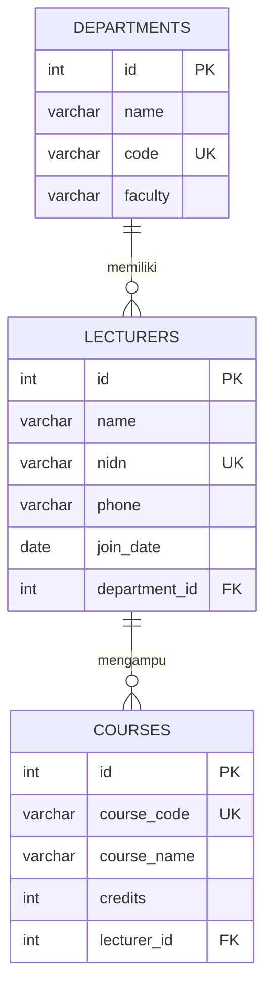

- `lecturers.department_id` merujuk ke `departments.id` (`ON DELETE SET NULL ON UPDATE CASCADE`).
- `courses.lecturer_id` merujuk ke `lecturers.id` (`ON DELETE CASCADE ON UPDATE CASCADE`).

---

## 2. Alur Program

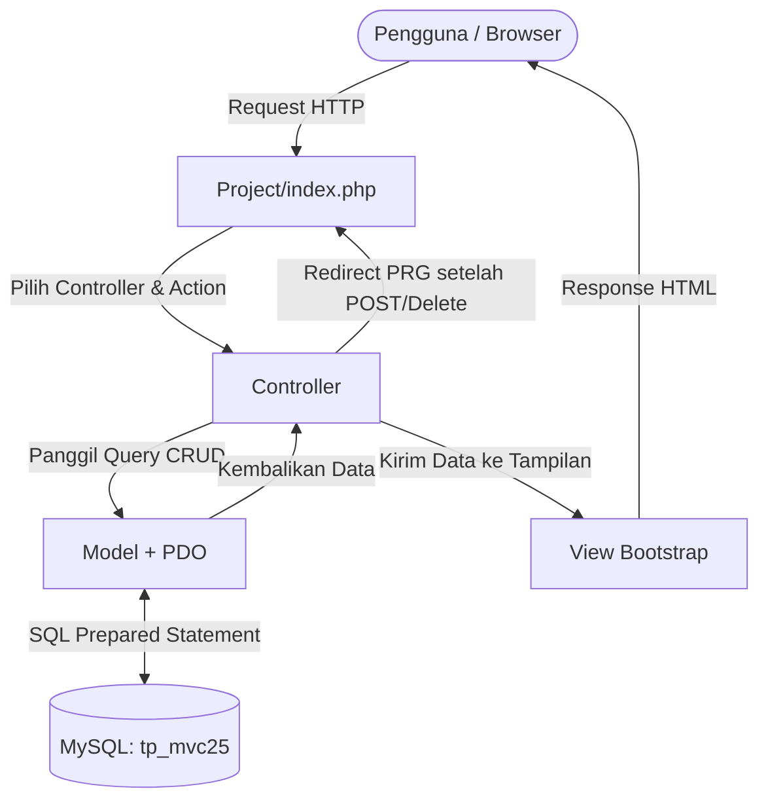

1. **Read (`index`)**: `index.php` meneruskan permintaan ke `index()` pada Controller terkait. Controller mengambil data melalui Model (`getAll()`) dan memanggil View `index.php` untuk menampilkan tabel.
2. **Create (`create` & `store`)**: `create()` menampilkan form input beserta daftar relasi (departemen pada form dosen, dosen pada form mata kuliah). Pengiriman form menuju `store()` memvalidasi input, menyimpan data via Model (`create()`), lalu melakukan redirect ke halaman `index`.
3. **Update (`edit` & `update`)**: `edit($id)` mengambil data berdasarkan ID via Model (`getById()`) untuk mengisi form ubah. Pengiriman form menuju `update()` memperbarui baris di database via Model (`update()`), lalu redirect ke halaman `index`.
4. **Delete (`delete`)**: `delete($id)` menghapus baris berdasarkan ID melalui Model (`delete()`), lalu redirect kembali ke halaman `index`.

---

## 3. Panduan Menjalankan Program

### Prasyarat
- **PHP**: Versi 7.4 atau lebih baru (dengan ekstensi `pdo_mysql`).
- **Database**: MySQL / MariaDB (port default `3306`).

### Langkah Menjalankan
1. Nyalakan layanan MySQL, lalu impor berkas `tp_mvc25.sql` untuk membuat database `tp_mvc25` beserta tabel dan data awal:
   ```bash
   mysql -u root < tp_mvc25.sql
   ```
2. Sesuaikan konfigurasi koneksi pada `Project/config/Database.php` apabila *username* atau *password* MySQL berbeda.
3. Jalankan server PHP dari dalam direktori `Project/`:
   ```bash
   cd Project
   php -S localhost:8000
   ```
4. Buka browser dan akses `http://localhost:8000`.

---

## 4. Dokumentasi Program Saat Dijalankan

### A. Modul Dosen (*Lecturers*)
1. **Daftar Dosen Awal**
   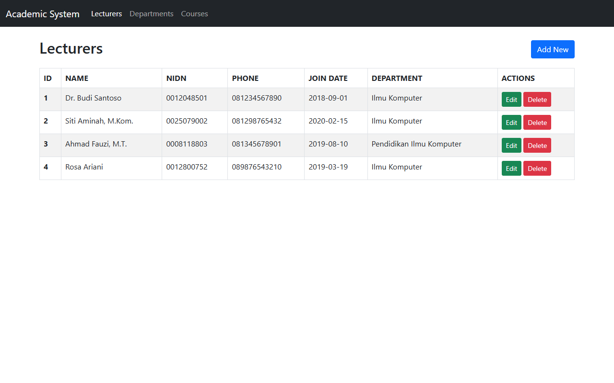
2. **Form Tambah Dosen**
   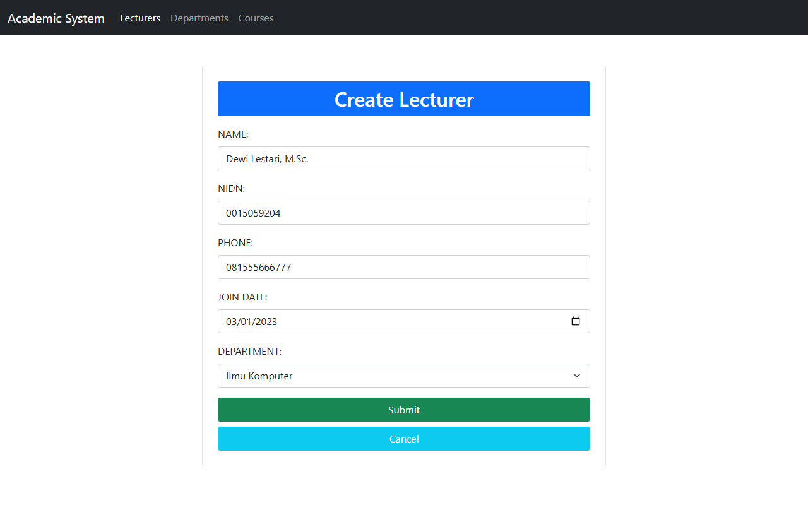
3. **Hasil Tambah Dosen**
   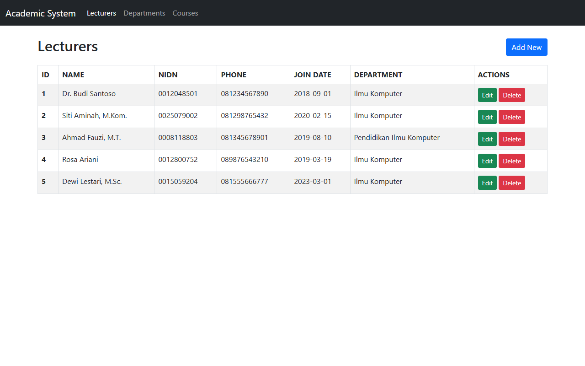
4. **Form Ubah Data Dosen**
   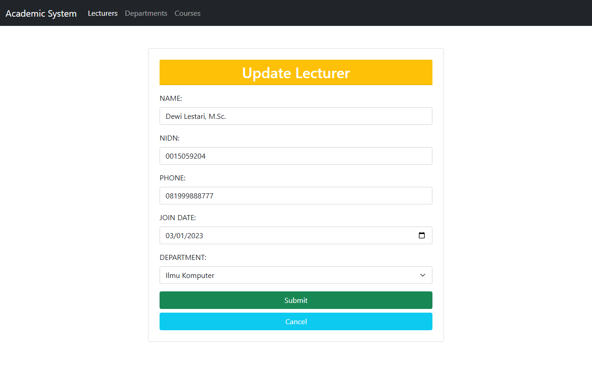
5. **Hasil Ubah Data Dosen**
   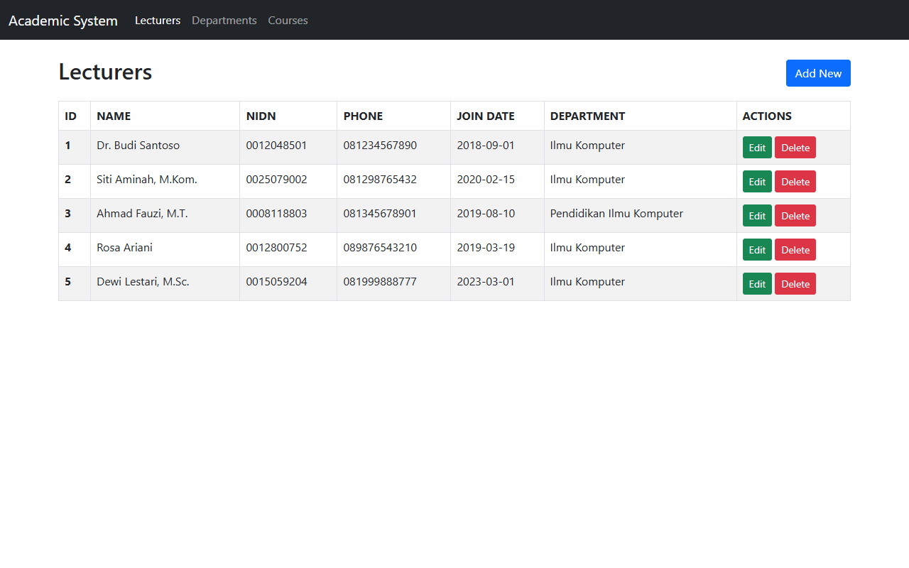
6. **Hasil Hapus Data Dosen**
   

### B. Modul Departemen (*Departments*)
1. **Daftar Departemen**
   
2. **Form Tambah Departemen**
   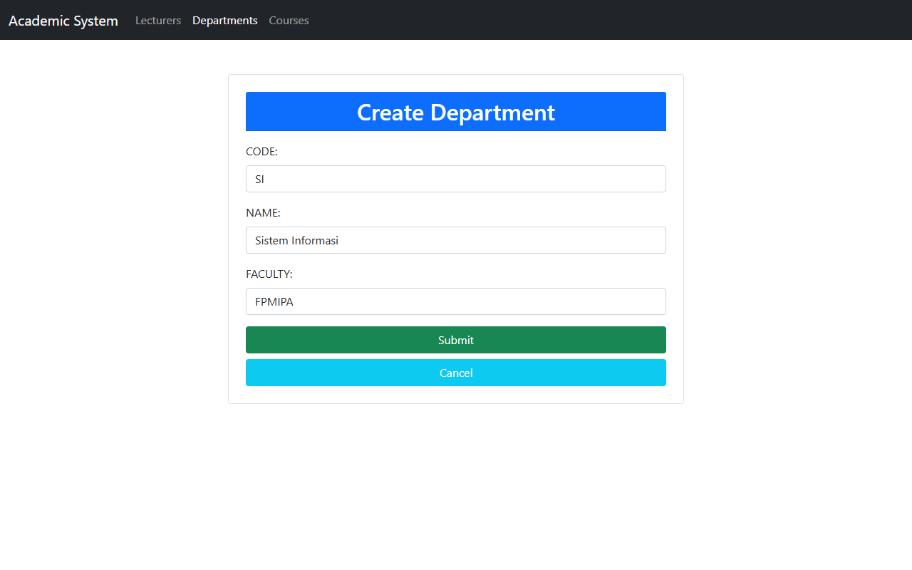
3. **Hasil Tambah Departemen**
   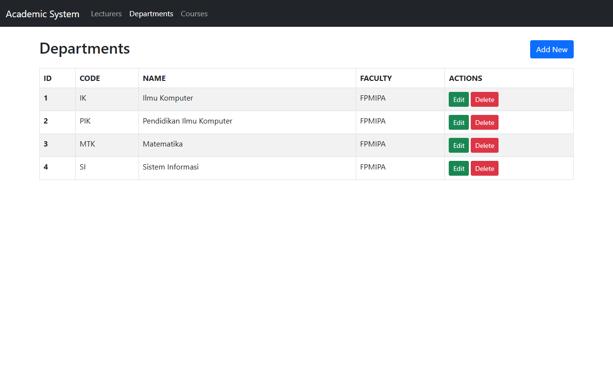
4. **Form Ubah Data Departemen**
   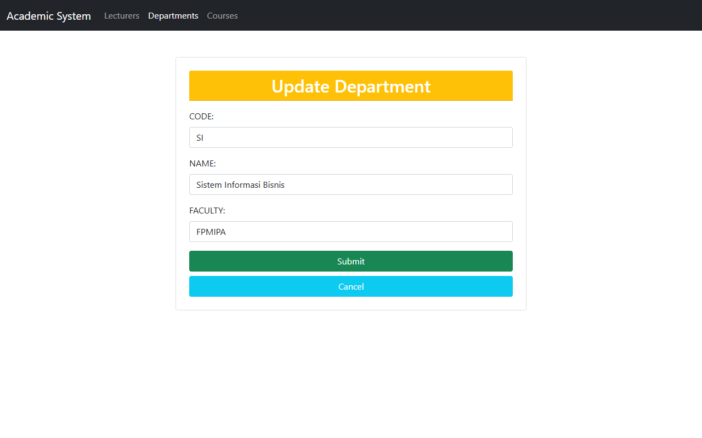
5. **Hasil Ubah Data Departemen**
   
6. **Hasil Hapus Data Departemen**
   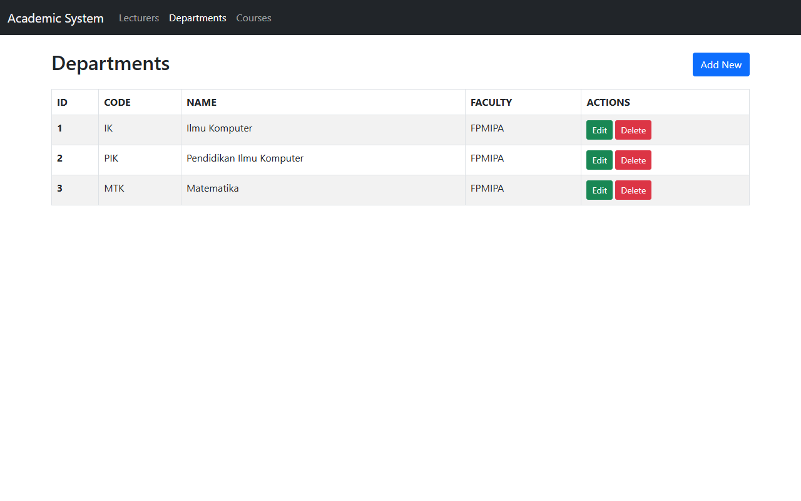

### C. Modul Mata Kuliah (*Courses*)
1. **Daftar Mata Kuliah**
   
2. **Form Tambah Mata Kuliah**
   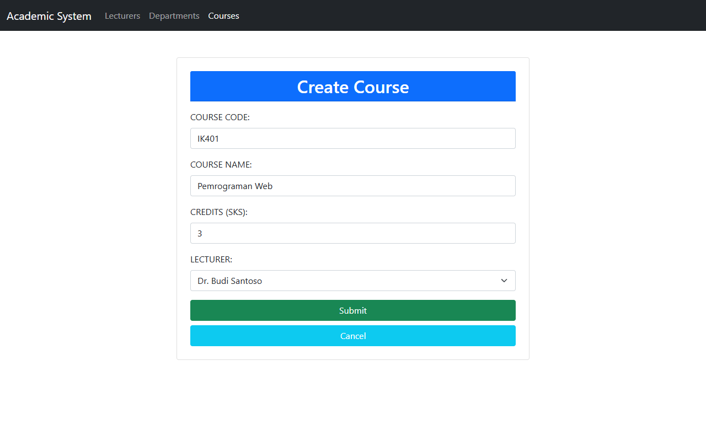
3. **Hasil Tambah Mata Kuliah**
   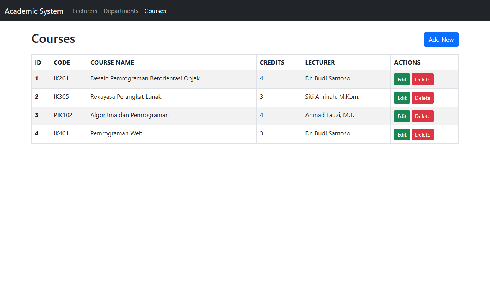
4. **Form Ubah Data Mata Kuliah**
   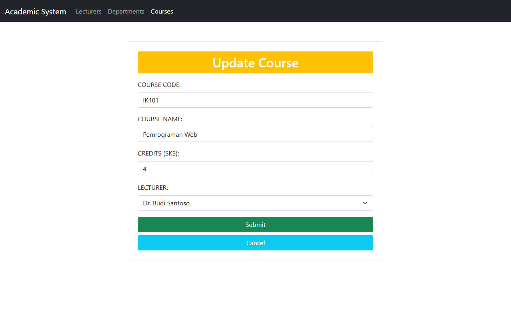
5. **Hasil Ubah Data Mata Kuliah**
   
6. **Hasil Hapus Data Mata Kuliah**
   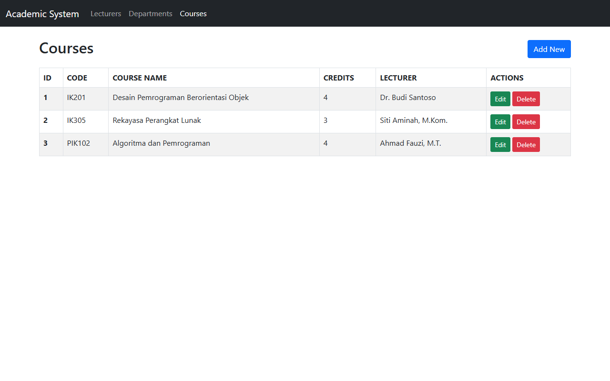
